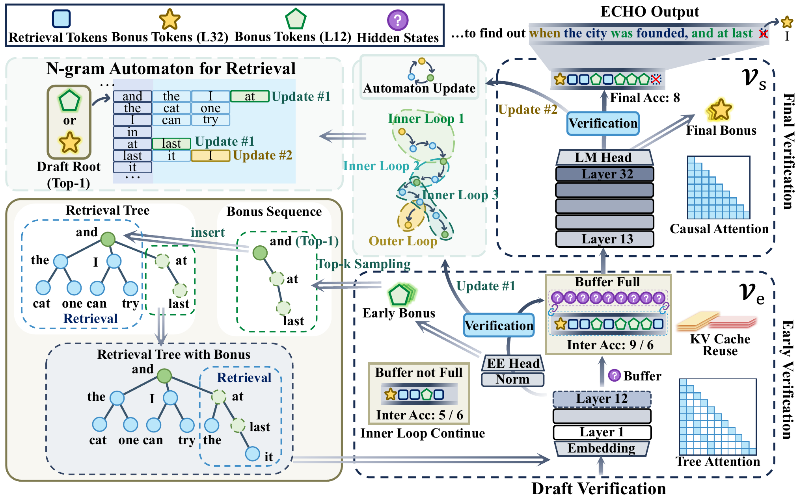

<div align="center">

# ECHO

**Early-layer Collaborative Hierarchical Orchestration with Bonus Logits in Speculative Decoding**

Speculative decoding for LayerSkip, looped transformers, and recurrent language models.

[](https://arxiv.org/abs/2609.17241)
[]()
[]()

</div>

ECHO implements speculative decoding in PyTorch and SGLang for LayerSkip and
looped/recurrent transformers, including Ouro, Huginn, recurrent Llama,
TinyLlama, and OLMo. It verifies draft trees with early layers or recurrent
iterations, then reuses those states for final verification.

Paired AR/ECHO benchmarks report throughput, mean accepted tokens (MAT),
and speedup.

## News

- **2026-11-21:** Added looped-transformer support with **Torch and native SGLang backends**, including paired AR/ECHO evaluation of throughput, mean accepted tokens (MAT), and speedup. See [Looped transformers](#looped-transformers).

## Acknowledgements

This codebase is based on [RACER](https://github.com/hkr04/RACER). Experiments use official [LayerSkip](https://github.com/facebookresearch/LayerSkip) weights. Looped-transformer support uses the released [Ouro](https://huggingface.co/ByteDance/Ouro-1.4B), [Huginn](https://huggingface.co/tomg-group-umd/huginn-0125), and [recurrent Llama, TinyLlama, and OLMo](https://huggingface.co/smcleish) weights.

## Overview

<p align="center">
  
</p>

Draft-model-free speculative decoding is cheap to deploy, but it hits two walls. **Verification** still runs the full target stack on every draft, so cost barely falls when drafts are wrong (the *verification wall*). **Drafts** themselves are often stale: if bonus logits come only from the last layer, they refresh only after a full forward pass, and acceptance decays quickly with depth.

ECHO uses early layers or recurrent iterations to verify draft trees, reducing how often final verification runs. These stages also produce early bonus logits that predict upcoming tokens and refresh the retrieval automaton during drafting.

The remaining layers or iterations confirm the accepted block and supply final bonus logits for the next cycle. ECHO uses a single target model and its existing output head. The paper reports speedups of about \(2.4\times\)–\(2.9\times\) on LayerSkip checkpoints.

See the [paper](https://arxiv.org/pdf/2609.17241) for details.

## Quick Start

### Looped transformers

ECHO uses the first K recurrent iterations for early verification and the
remaining iterations for final verification. The six checkpoints use these
recurrent schedules:

| Model | Full recurrence S | Early readout K |
| --- | ---: | ---: |
| [Ouro-1.4B](https://huggingface.co/ByteDance/Ouro-1.4B), [Ouro-2.6B](https://huggingface.co/ByteDance/Ouro-2.6B) | 4 | 1 |
| [Huginn-0125](https://huggingface.co/tomg-group-umd/huginn-0125) | 32 | 8 |
| [Raven-Llama-3.2](https://huggingface.co/smcleish/Recurrent-Llama-3.2-train-recurrence-32) | 32 | 4 |
| [Recurrent-TinyLlama-3T-train-recurrence-32](https://huggingface.co/smcleish/Recurrent-TinyLlama-3T-train-recurrence-32) | 32 | 4 |
| [Recurrent-OLMo-2-0425-train-recurrence-32](https://huggingface.co/smcleish/Recurrent-OLMo-2-0425-train-recurrence-32) | 32 | 4 |

#### 1. Set up a backend

Use separate Python 3.11 environments for Torch and SGLang, with a
CUDA-enabled PyTorch build compatible with your driver. From the repository root:

```bash
# Torch
python3.11 -m venv .venv-looped-torch
.venv-looped-torch/bin/pip install -r requirements-looped.txt
.venv-looped-torch/bin/pip install -e ./echo/automaton

# SGLang
python3.11 -m venv .venv-looped-sglang
.venv-looped-sglang/bin/pip install -r requirements-looped-sglang.txt
.venv-looped-sglang/bin/pip install -e ./echo/automaton
```

Place the model checkpoints under `./checkpoints/`.

#### 2. Prepare benchmark inputs

Prepare one JSON list or JSONL file per benchmark, such as HumanEval+,
MBPP+, MATH-500, BBH, or GSM8K. Each request supplies a prompt with the
model's chat template already applied, where applicable:

```json
{"id":"example-0","prompt":"Solve: 17 * 23 =","stop":["\n\nQ:"]}
```

Text prompts are tokenized as supplied; include the model's BOS and chat
markers in the rendered input.

Frozen inputs can instead provide `input_ids`, with `prompt_id`, `doc_id`,
`eos_token_ids`, and `until`. AR and ECHO use the same inputs, order, seeds,
and stops.

#### 3. Measure AR and ECHO

For Ouro-1.4B on Torch:

```bash
CUDA_VISIBLE_DEVICES=0 .venv-looped-torch/bin/python -m evaluation.benchmark_looped \
  --model-path ./checkpoints/Ouro-1.4B \
  --backend torch --shallow-steps 1 --mode paired \
  --input-file ./prompts.jsonl --output-file ./outputs/ouro-torch.jsonl \
  --seed 1234 --max-new-tokens 1024 --context-length 2048
```

Run the same comparison on SGLang:

```bash
CUDA_VISIBLE_DEVICES=0 .venv-looped-sglang/bin/python -m evaluation.benchmark_looped \
  --model-path ./checkpoints/Ouro-1.4B \
  --backend sglang --shallow-steps 1 --mode paired \
  --input-file ./prompts.jsonl --output-file ./outputs/ouro-sglang.jsonl \
  --seed 1234 --max-new-tokens 1024 --context-length 2048
```

For another model, change `--model-path` and set `--shallow-steps` to its K
above. Repeat for each benchmark file. Defaults are greedy BF16 decoding,
64 draft nodes including the root, breadth 8, n-gram length 10, and
verification threshold 5. Generation respects EOS and task stops.

Paired mode warms the kernels and checks output agreement before timing.
Each run writes raw token IDs and timings to JSONL, with decode tok/s, MAT,
and same-backend ECHO/AR speedup in the adjacent `.summary.json`. Use
`--mode echo` or `--mode ar` for one method, or append `--resume` to continue
an interrupted run.

See the [looped-transformer guide](docs/looped_transformers.md) for metric
definitions, the Python API, single-prompt generation, and tests.

### LayerSkip

Use the SGLang environment above for generation and paired evaluation:

```bash
# Single prompt
CUDA_VISIBLE_DEVICES=0 .venv-looped-sglang/bin/python -m evaluation.inference_layerskip \
  --model-path ./checkpoints/layerskip-llama3-8B --intermediate-layer 10 \
  --prompt '<|begin_of_text|>The capital of France is' --max-new-tokens 64

# Paired AR/ECHO benchmark
CUDA_VISIBLE_DEVICES=0 .venv-looped-sglang/bin/python -m evaluation.benchmark_layerskip \
  --model-path ./checkpoints/layerskip-llama3-8B --intermediate-layer 10 \
  --mode paired --input-file ./prompts.jsonl \
  --output-file ./outputs/layerskip-sglang.jsonl
```

See [LayerSkip on SGLang](docs/layerskip_sglang.md) for input formatting,
metrics, and correctness checks.

#### 1. Download LayerSkip weights

Checkpoints are in the Hugging Face collection [facebook/layerskip](https://huggingface.co/collections/facebook/layerskip) (gated, FAIR non-commercial license). Request access, then log in:

```bash
huggingface-cli login
```

| Family | Models |
| --- | --- |
| Llama 2 | [`7B`](https://huggingface.co/facebook/layerskip-llama2-7B) · [`13B`](https://huggingface.co/facebook/layerskip-llama2-13B) · [`70B`](https://huggingface.co/facebook/layerskip-llama2-70B) |
| Llama 3 | [`8B`](https://huggingface.co/facebook/layerskip-llama3-8B) |
| Llama 3.2 | [`1B`](https://huggingface.co/facebook/layerskip-llama3.2-1B) |
| CodeLlama | [`7B`](https://huggingface.co/facebook/layerskip-codellama-7B) · [`34B`](https://huggingface.co/facebook/layerskip-codellama-34B) |

Example ([facebook/layerskip-llama3-8B](https://huggingface.co/facebook/layerskip-llama3-8B)):

```bash
huggingface-cli download facebook/layerskip-llama3-8B \
  --local-dir ./checkpoints/layerskip-llama3-8B
```

#### 2. Environment

For Torch, use Python 3.10 and CUDA 11.8 (`torch==2.7.1+cu118`). System `g++` is required to build the automaton.

```bash
conda create -n echo python=3.10 -y
conda activate echo
pip install -r requirements.txt
# fschat 0.2.31 still declares pydantic<2; overlay to match the working stack
pip install pydantic==2.12.5 pydantic_core==2.41.5 fastapi==0.120.3 uvicorn==0.38.0
pip install -e ./echo/automaton
```

Rebuild the automaton if you change Python version.

#### 3. Run

From the repo root. Default decode is greedy (`temperature=0`); stop is eos only. `--bench-name`: `spec_bench` | `human_eval` | `gsm8k` | `mgsm`.

```bash
CUDA_VISIBLE_DEVICES=0 python evaluation/inference_echo.py \
  --model-path ./checkpoints/layerskip-llama3-8B \
  --model-id layerskip-llama3-8B \
  --bench-name spec_bench \
  --intermediate-layer 10 \
  --verification-threshold 3 \
  --max-nodes 30000 \
  --no-bottleneck-log
```

Swap `--bench-name` for `human_eval` or `gsm8k`. Answers go to `data/<bench>/model_answer/<model-id>-echo-L{L}-T{T}_<timestamp>.jsonl`.

Vanilla AR (same prompts, no speculation):

```bash
CUDA_VISIBLE_DEVICES=0 python evaluation/inference_vanilla.py \
  --model-path ./checkpoints/layerskip-llama3-8B \
  --model-id layerskip-llama3-8B \
  --bench-name spec_bench
```

Speed vs. vanilla:

```bash
python evaluation/speed.py data/spec_bench/model_answer/<echo>.jsonl \
  --base-path data/spec_bench/model_answer/<vanilla>.jsonl
```

## Citation

```bibtex
@article{ma2026echo,
  title={ECHO: Early-layer Collaborative Hierarchical Orchestration with Bonus Logits in Speculative Decoding},
  author={Ma, Ziyang and Zhang, Zihong and Li, Zuchao and Zhang, Lefei and Qi, Baoyuan and Li, Siqi and Yu, Simin},
  journal={arXiv preprint arXiv:2609.17241},
  year={2026}
}
```
